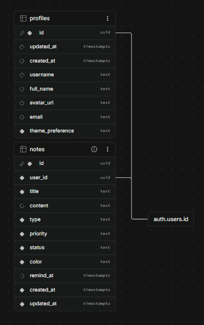

# Onti Notes App — MVP

Aplicación full-stack de notas y recordatorios personales con autenticación de usuarios, gestión por columnas Kanban/Canvas, personalización de colores, carga dinámica y soporte nativo para Tema Claro/Oscuro (Light/Dark Mode).

---

## 🛠️ Stack Tecnológico

- **Frontend:** Next.js (App Router), React, TypeScript (Strict Mode).
- **Estilos & UI:** Tailwind CSS, Lucide Icons, `next-themes` (Soporte Light/Dark/System).
- **Backend & Database:** Supabase (PostgreSQL, Supabase Auth con Cookies/SSR, Row Level Security - RLS).
- **Manejo de Estado & Servidor:** Server Actions (Patrón Controller).

---

## 💾 Base de Datos y Seguridad (Supabase)

El esquema de la base de datos está diseñado en PostgreSQL utilizando **Row Level Security (RLS)** para aislar la información por usuario.

### 📊 Diagrama de Entidad-Relación



## 📁 Arquitectura del Proyecto

```text
.
├── actions/        # Server Actions (Controladores / Lógica de backend aislada)
├── app/            # Rutas, layouts y vistas principales (App Router)
├── components/     # Componentes de UI modulares y reutilizables
├── docs/           # Archivos de referencia para trabajo con vistas y esquema de base de datos.
├── lib/            # Clientes de integración (Supabase Server/Client)
├── types/          # Definiciones e interfaces de TypeScript
├── prompts/        # Registro documentado de Prompts e interacciones con IA
├── schema.sql      # Esquema de base de datos, triggers, RLS y funciones de Supabase
└── CLAUDE.md       # Archivo maestro de reglas y contexto de arquitectura
```

---

## ⚙️ Requisitos Previos

Asegúrate de contar con lo siguiente instalado en tu equipo:
- **Node.js**: v18.0.0 o superior.
- **npm**: v9.0.0 o superior.
- **Cuenta en Supabase**: Proyecto activo en [supabase.com](https://supabase.com).

---

## 🚀 Guía de Instalación y Despliegue Local

Sigue estos pasos para ejecutar la aplicación en cualquier entorno de desarrollo:

### 1. Clonar el repositorio
```bash
git clone <URL_DE_TU_REPOSITORIO>
cd onti-notes-app
```

### 2. Instalar dependencias
```bash
npm install
```

### 3. Configurar la Base de Datos en Supabase
1. Ve a tu panel de control de Supabase → **SQL Editor**.
2. Abre el archivo `schema.sql` ubicado en la raíz de este repositorio, copia su contenido y ejecútalo en el editor SQL de Supabase.
3. Este script creará:
   - Tabla `notes` con sus restricciones de validación y políticas RLS.
   - Tabla `profiles` vinculada con los usuarios de `auth.users`.
   - Triggers automáticos para creación de perfil (`on_auth_user_created`) y actualización de `updated_at`.
   - Bucket de almacenamiento para `avatars`.

Si el proyecto ya existe, aplica `migracion_avatars_storage.sql` para habilitar la subida de fotos desde la edición del perfil: configura `avatars` como privado, limita JPEG/PNG/WebP a 2 MiB y restringe el acceso a cada propietario. No borra ni mueve archivos existentes. Revisa los pasos y las comprobaciones en [AUTH_SETUP.md](./AUTH_SETUP.md#configurar-la-subida-de-fotos-en-supabase).

### 4. Configurar Variables de Entorno
Crea un archivo `.env.local` en la raíz del proyecto basándote en el archivo de ejemplo:

```bash
cp .env.example .env.local
```

Rellena las variables con las credenciales de tu proyecto de Supabase (las cuales encuentras en **Project Settings -> API**):

```env
NEXT_PUBLIC_SUPABASE_URL=tu_supabase_project_url
NEXT_PUBLIC_SUPABASE_ANON_KEY=tu_supabase_anon_key
```

### 5. Configuración de Autenticación (Supabase Dashboard)
1. Ve a **Authentication -> Providers -> Email** y asegúrate de que el proveedor por correo esté activo.
2. En **Authentication -> URL Configuration -> Redirect URLs**, agrega: `http://localhost:3000` (o la URL de tu entorno de despliegue).

### 6. Ejecutar en Entorno de Desarrollo
```bash
npm run dev
```
Abre tu navegador en `http://localhost:3000`.

---

## 🛠️ Comandos Principales

- `npm run dev`: Inicia el servidor de desarrollo local.
- `npm run build`: Valida tipos de TypeScript y compila la app para producción.
- `npm run start`: Inicia el servidor con la build compilada.
- `npm run lint`: Ejecuta las verificaciones de código de ESLint.

---

## 🤖 Uso de Inteligencia Artificial (Prompt Engineering)

El desarrollo de este proyecto se apoyó en herramientas de IA (ChatGPT y ChatGPT Codex en VS Code) actuando como **Software Architect, Lead Full-Stack Engineer y UX/UI Designer**.

Toda la trazabilidad de esta interacción se encuentra documentada en la carpeta `/prompts`:
- `01-chatgpt-prompt.md`: Definición inicial y ajustes de arquitectura, reglas de negocio en `CLAUDE.md`, SQL Schema y vistas iniciales.
- `02-vscode-chatgpt-codex.md`: Generación de Server Actions, formularios de UI, correcciones de flujos de auth, modo claro/oscuro y Drag and Drop.
- `03-optimizaciones-y-fase-final.md`: Implementación de carga dinámica, paginación de notas y refinamiento de rendimiento en el dashboard.
